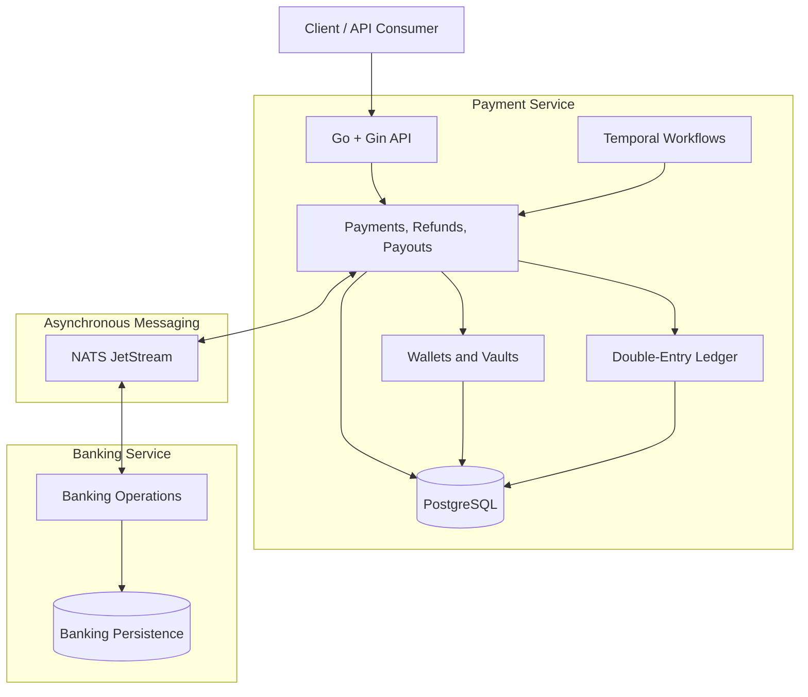

# SamPay 💳

<p align="center">
  <strong>A distributed payment and banking platform built with Go, PostgreSQL, Temporal, and NATS JetStream.</strong>
</p>

<p align="center">
  
  
  
  
  
</p>

<p align="center">
  
  
  
</p>

---

## 🚀 Overview

**SamPay** is a backend-focused payment and banking platform built to explore the engineering challenges behind financial systems: accounting correctness, concurrent transactions, asynchronous communication, workflow orchestration, and failure recovery.

The system separates payment-platform responsibilities from banking operations through two services that communicate asynchronously using **NATS JetStream**. PostgreSQL maintains persistent financial state, while Temporal orchestrates long-running business processes and recovery.

### Key capabilities

- 💳 Payment processing and payment lifecycle management
- 💰 Wallets, payment vaults, and company vaults
- 📒 Double-entry ledger and financial transaction tracking
- 💸 Wallet-to-bank and bank-to-bank transfers
- 🔄 Bank-to-wallet and bank-to-vault transfers
- ↩️ Refunds and payouts
- 📅 Settlement and internal ledger reconciliation
- 🔁 Idempotent APIs and duplicate-request handling
- 🔒 Wallet reservations, database transactions, and row-level locking
- ⚡ Asynchronous service-to-service communication with NATS JetStream
- ⏱️ Temporal workflows, retries, and failure recovery
- 🧪 Automated tests and concurrent-request testing

SamPay is a personal engineering project, not a production payment service. Its purpose is to build and test realistic backend financial workflows while exploring the trade-offs involved in distributed systems.

## 🏗️ Architecture

SamPay consists of two services:

- **Payment Service:** Exposes payment APIs and coordinates payments, refunds, payouts, wallets, settlements, reconciliation, and related financial workflows.
- **Banking Service:** Handles banking operations and transfer flows, communicating asynchronously with the Payment Service through NATS JetStream.

Temporal orchestrates long-running business workflows. PostgreSQL stores persistent application and financial state.


### Design principles

- **Financial correctness:** Represent money movement explicitly through ledger entries and database transactions.
- **Clear service boundaries:** Keep payment orchestration separate from banking operations.
- **Asynchronous communication:** Use NATS JetStream for communication between services.
- **Durable workflow orchestration:** Use Temporal for long-running processes, retries, and recovery.
- **Safe retries:** Combine API idempotency, workflow identity, and transactional safeguards to control duplicate processing.
- **Testability:** Validate financial state transitions and failure paths, not just successful API responses.

## 💰 Financial Architecture

### Double-entry ledger

SamPay uses a double-entry ledger to represent financial movements across **five transaction types and three account types**.

Each ledger transaction must satisfy the accounting invariant:

```text
Total Debits = Total Credits
```

Financial mutations and associated ledger entries are coordinated within database transactions to maintain consistency.

The ledger supports tracking movements between merchant wallets, payment vaults, company vaults, and banking-related accounts.

### Example: Wallet-to-bank payout

For a payout of ₹1,000 with a ₹10 fee:

```text
Merchant Wallet
      |
      | Debit ₹1,010
      v
  Payout Vault
      |
      +---- Credit ₹1,000 ----> Bank Account
      |
      +---- Credit ₹10 -------> Company Vault
```

The corresponding ledger entries record the movement of the payout amount and the fee. The transaction must balance before the financial operation is committed.

## 💳 Core Financial Flows

### Payments

The payment flow coordinates validation, fee calculation, payment creation, wallet operations, vault movements, and ledger updates.

Implemented capabilities include:

- Payment creation and status management
- Idempotency-key handling
- Payment expiry and long-lived payment flows
- Manual payment refresh
- Wallet reservations
- Automated wallet top-ups
- Payment-vault and company-vault accounting
- Fee accounting and double-entry ledger entries

### Payouts and transfers

SamPay supports several transfer paths across the payment and banking services.

| Transfer flow | Description |
|---|---|
| Wallet → Bank | Transfers funds from a wallet to a bank account, including applicable fees and ledger entries. |
| Bank → Bank | Transfers funds between source and destination bank accounts. |
| Bank → Wallet | Moves funds from a bank account into a wallet. |
| Bank → Vault | Moves funds from a bank account into a vault. |

The banking flows communicate across service boundaries using NATS JetStream rather than relying exclusively on synchronous in-process calls.

### Refunds

Refund processing depends on the settlement state of the original payment.

- **Before settlement:** Funds can be returned from the payment vault.
- **After settlement:** Refunds can be funded from the merchant wallet.
- **Insufficient wallet balance:** The system can initiate an automated top-up from the linked primary bank account before processing the refund.

Refund execution, financial mutations, and ledger updates are coordinated through the corresponding business flow.

### Automated wallet top-ups

Automatic top-ups are treated as financial transactions, not direct balance modifications.

A top-up records the movement from a linked bank account into the merchant wallet and creates corresponding ledger entries. This makes the operation auditable and available for reconciliation.

### Settlement

Settlement moves eligible merchant funds from reserved balances into available balances and updates the corresponding payment state.

Temporal orchestrates settlement workflows, including scheduled execution.

## 🔎 Reconciliation

SamPay implements internal ledger reconciliation to validate accounting integrity.

The reconciliation process:

1. Retrieves ledger transactions and their entries.
2. Groups entries by transaction.
3. Calculates total debits and credits.
4. Identifies transactions where the totals do not match.
5. Records discrepancies and generates a report.
6. Supports delivery of the reconciliation report through email.

A discrepancy report can include:

- Ledger transaction ID
- Reference ID
- Total debit
- Total credit
- Difference between the two totals

This provides a way to identify accounting inconsistencies instead of relying solely on API responses or payment statuses.

## ⏱️ Temporal Workflow Orchestration

Temporal manages long-running business processes that should not depend entirely on a single HTTP request remaining active.

SamPay implements **nine Temporal workflows** spanning payment operations, refunds, merchant onboarding, and reconciliation.

Workflow orchestration covers:

- Payment processing
- Payouts and refunds
- Settlement and reconciliation
- Merchant onboarding
- Activity retries and failure handling
- Recovery following temporary workflow-service interruptions

Deterministic workflow IDs are used to control duplicate workflow starts across retries and restarts.

The workflow layer coordinates business operations, while financial mutations are handled by application services and activities. Idempotency and database safeguards remain important because workflow retries do not, by themselves, guarantee exactly-once execution of external side effects.

## 📡 NATS JetStream

NATS JetStream provides asynchronous communication between the Payment Service and Banking Service.

The integration uses a dedicated banking event stream and explicit message acknowledgements.

Current messaging conventions include:

| Component | Configuration |
|---|---|
| Stream | `BANKING_EVENTS` |
| Payment-to-banking subjects | `sampay.bank.>` |
| Banking-to-payment subjects | `bank.sampay.>` |
| Durable consumer | `BANKING_COMMANDS` |
| Acknowledgement strategy | Explicit acknowledgement |

This separation allows the services to communicate through messages and handle banking operations independently of the initiating API request.

Message delivery and workflow recovery still require application-level safeguards to prevent duplicate financial effects.

## 🔐 Idempotency and Concurrency

Financial systems must handle retries, simultaneous requests, and ambiguous failures without creating unintended duplicate transactions.

### Idempotency

Payment requests support idempotency keys scoped to the merchant.

```text
(merchant_id, idempotency_key)
```

The implementation uses a database-enforced uniqueness constraint and an atomic insert-first approach rather than relying on a separate read-then-write sequence.

The API distinguishes between requests that are still processing and requests that can return a previously stored response.

### Database transactions and locking

SamPay uses PostgreSQL transactions and row-level locking where required.

```sql
SELECT ...
FROM wallets
WHERE merchant_id = ?
FOR UPDATE;
```

These mechanisms help serialize conflicting balance updates and prevent concurrent operations from modifying the same financial state without synchronization.

Wallet reservations and timeout-based release logic further help manage funds during in-progress operations.

The objective is to preserve financial invariants across concurrent requests, retries, and failures—not merely to return successful HTTP responses.

## 🧪 Testing and Reliability

The project includes automated tests across core payment logic and APIs, with **77% test coverage**.

Testing focuses on financial state transitions, concurrency, and failure handling.

Areas covered include:

- Payment processing and transactional financial updates
- Idempotency under concurrent requests
- Concurrent payment and automated top-up scenarios
- Temporal activity failure and retry behavior
- Workflow recovery following Temporal interruptions
- Financial state and ledger consistency

### Workflow retry experiment

A temporary failure was injected into the payment execution activity to verify retry behavior.

Example retry configuration:

```text
Initial interval:      2 seconds
Backoff coefficient:   2.0
Maximum interval:      30 seconds
Maximum attempts:      5
```

The workflow retried the failed activity and completed after a subsequent successful attempt.

### Temporal interruption experiment

A load test was also performed while Temporal was temporarily stopped and restarted.

One recorded experiment used:

```text
Request rate:            2 requests/second
Duration:                30 seconds
Total requests:          60
```

During that experiment, some HTTP requests returned errors while their underlying workflows subsequently completed after Temporal recovered. This demonstrated why an HTTP error does not always mean the financial operation failed, and why idempotency and state inspection are important when clients retry after ambiguous outcomes.

These results describe a specific development experiment, not a guarantee of production availability or fault tolerance.

## ⚡ Load Testing

SamPay includes custom Go-based load-testing utilities for evaluating API behavior and financial consistency under concurrent requests.

The testing approach considers:

- Request throughput
- Response latency
- Success and failure rates
- Concurrent financial operations
- Database contention
- Balance consistency
- Workflow behavior during infrastructure interruptions

Load-testing results are used to identify correctness issues and understand system behavior before introducing further complexity.

## 🛠️ Technology Stack

| Technology | Purpose |
|---|---|
| **Go** | Backend services and business logic |
| **Gin** | HTTP API framework |
| **GORM** | Database access |
| **PostgreSQL** | Persistent application and financial state |
| **Temporal** | Durable workflow orchestration, retries, and recovery |
| **NATS JetStream** | Asynchronous service-to-service communication |
| **Docker** | Local infrastructure where configured |
| **Go testing tools** | Automated tests and reliability validation |

## 🚀 Local Setup

SamPay requires its application dependencies and infrastructure services to be configured locally.

### Prerequisites

- [Go](https://go.dev/)
- [PostgreSQL](https://www.postgresql.org/)
- [Temporal CLI](https://docs.temporal.io/cli)
- [NATS Server with JetStream](https://docs.nats.io/)
- Git
- Docker, if using a containerized local environment

### 1. Clone the repository

```bash
git clone https://github.com/Srivastava-samarth/SamPay.git
cd SamPay
```

### 2. Install Go dependencies

```bash
go mod download
```

### 3. Configure PostgreSQL

Create the required database or databases and configure the connection settings expected by each service.

Example database creation:

```sql
CREATE DATABASE sampay;
```

Use the repository's application configuration for connection details, credentials, and any additional banking-service persistence requirements.

### 4. Start Temporal

For local development, start a Temporal development server:

```bash
temporal server start-dev
```

The default local endpoints are:

```text
Temporal Server: localhost:7233
Temporal UI:     http://localhost:8233
```

### 5. Start NATS JetStream

Start a NATS server with JetStream enabled and configure the connection settings expected by both services.

Ensure the banking event stream, subjects, and durable consumer are configured consistently with the application.

### 6. Configure and start the services

Set the database, Temporal, NATS, and application settings required by the repository. Start the Payment Service and Banking Service according to their respective entry points and configuration.

The Payment Service API uses port `8080` in the existing local setup.

```text
http://localhost:8080
```

### 7. Run tests

Run the Go test suite:

```bash
go test ./...
```

Run tests with the race detector:

```bash
go test -race ./...
```

Run tests with verbose output:

```bash
go test -v ./...
```

## 📁 Project Focus

SamPay explores the engineering trade-offs involved in building financial backends, particularly:

- Double-entry accounting and financial invariants
- Transactional database operations
- Idempotency and duplicate-request handling
- Concurrent balance updates and row-level locking
- Durable workflow orchestration
- Asynchronous service communication
- Banking and payment service boundaries
- Reconciliation and discrepancy reporting
- Retry behavior and failure recovery
- Automated testing and load testing

## ⚠️ Disclaimer

SamPay is a personal learning and engineering project. It is **not intended to process real money or serve as a production payment platform**.

Its implementation demonstrates selected payment and distributed-systems concepts, but it has not been represented as independently audited, production-certified, or ready for real financial operations.

## 👨‍💻 Author

**Samarth Srivastava**

Backend Software Engineer focused on payment systems, financial workflows, Go, and distributed systems.

- [GitHub](https://github.com/Srivastava-samarth)
- [LinkedIn](https://www.linkedin.com/in/samarth-srivastava94)

---

<p align="center">
  <strong>Build it. Understand it. Break it. Scale it. Fix it.</strong>
</p>
